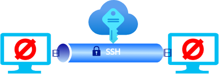
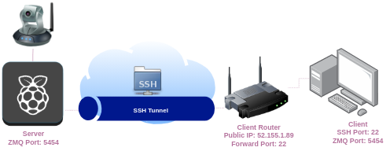

<!--
===============================================
vidgear library source-code is deployed under the Apache 2.0 License:

Copyright (c) 2019 Abhishek Thakur(@abhiTronix) <abhi.una12@gmail.com>

Licensed under the Apache License, Version 2.0 (the "License");
you may not use this file except in compliance with the License.
You may obtain a copy of the License at

   http://www.apache.org/licenses/LICENSE-2.0

Unless required by applicable law or agreed to in writing, software
distributed under the License is distributed on an "AS IS" BASIS,
WITHOUT WARRANTIES OR CONDITIONS OF ANY KIND, either express or implied.
See the License for the specific language governing permissions and
limitations under the License.
===============================================
-->

# SSH Tunneling Mode for NetGear API 

<h3 align="center">
  
</h3>


## Overview

??? new "New in v0.2.2" 
    This document was added in `v0.2.2`.


SSH Tunneling Mode allows you to connect NetGear client and server via secure SSH connection over the untrusted network and access its intranet services across firewalls. This mode works with pyzmq's [`zmq.ssh`](https://github.com/zeromq/pyzmq/tree/main/zmq/ssh) module for tunneling ZeroMQ connections over ssh.

This mode implements [SSH Local Port Forwarding](https://www.ssh.com/academy/ssh/tunneling/example) _(i.e. `ssh -L`, see [pyzmq's SSH tunneling docs](https://pyzmq.readthedocs.io/en/latest/howto/ssh.html))_ at the Server end, which forwards a local port on the Server machine through an SSH server _(here, the Client machine)_ to NetGear's port on that machine. Thereby, once you have established the tunnel, the Server's connections to its local port will actually be connections to the Client's NetGear port, as seen from the SSH server.

??? danger "Beware ☠️"
    Cybercriminals or malware could exploit SSH tunnels to hide their unauthorized communications, or to exfiltrate stolen data from the network. More information can be found [here ➶](https://www.ssh.com/academy/ssh/tunneling)

All patterns are valid for this mode and it can be easily activated in NetGear API at server end through `ssh_tunnel_mode` string attribute of its [`options`](../params/#options) dictionary parameter during initialization.

!!! warning "Important"
    * ==SSH tunneling mode can only be enabled on Server-end to establish remote SSH connection with Client.==
    * SSH tunneling mode requires Client's SSH Port(default `22`) to be TCP Port Forwarded by its Router, which allows Server machine to connect to it remotely.   
    * SSH tunneling mode is **NOT** compatible with [Multi-Servers](../advanced/multi_server/) and [Multi-Clients](../advanced/multi_client/) Exclusive Modes yet.
    * SSH tunneling mode only supports `tcp` [protocol](../params/#protocol). Using it with `ipc` protocol will result in `ValueError`.
    
!!! tip "Useful Tips"
    * It is advise to use `pattern=2` to overcome random disconnection due to delays in network. Also, use [`receive_timeout`](../params/#options) at Client's end with it, as its termination signal is best-effort.
    * SSH tunneling Mode is fully supports [Bidirectional Mode](../advanced/bidirectional_mode/), [Secure Mode](../advanced/secure_mode/) and [JPEG-Frame Compression](../advanced/compression/).
    * It is advised to enable logging (`logging = True`) on the first run, to easily identify any runtime errors.


&nbsp;


## Prerequisites 

SSH Tunnel Mode requires [`pexpect`](https://pexpect.readthedocs.io/) or [`paramiko`](https://www.paramiko.org/) as an additional dependency. pyzmq chooses the backend itself: `pexpect` on Linux/MacOS, and `paramiko` on Windows. The matching one is already included in VidGear's `core` and `asyncio` extras _(i.e. `pip install vidgear[core]`)_, otherwise it can be easily installed via pypi as follows:


=== "Paramiko"

    !!! info "`paramiko` is used by pyzmq on Windows machines."

    ```sh
    # install paramiko
    pip install paramiko
    ```

=== "Pexpect"

    !!! info "`pexpect` is used by pyzmq on Linux/MacOS machines, and is NOT compatible with Windows Machines."

    ```sh
    # install pexpect
    pip install pexpect
    ```

&nbsp;


## Exclusive Attributes

!!! warning "All these attributes will work on Server end only whereas Client end will simply discard them."

For implementing SSH Tunneling Mode, NetGear API currently provide following exclusive attribute for its [`options`](../params/#options) dictionary parameter:

* **`ssh_tunnel_mode`** (_string_) : This attribute activates SSH Tunneling Mode and assigns the SSH server to tunnel through, as `"<ssh-username>@<ssh-server-ip-address>:<ssh-port>"` SSH URL at Server end _(here, the SSH server is the Client machine at its public IP address and TCP forwarded SSH port)_. It is **NOT** an allow-list. Its usage is as follows:
  
    !!! failure "On Server end, NetGear automatically validates if the SSH `port` is reachable at specified SSH server's IP Address or not _(via a TCP connect)_, and if it fails _(i.e. port is closed)_, NetGear will throw `AssertionError`!"

    === "With Default Port"
        
        !!! info "The default port value in SSH URL is `22`, meaning Server assumes TCP Port `22` is forwarded on Client's end by default."

        ```python
        # activate SSH Tunneling and assign SSH URL
        options = {"ssh_tunnel_mode":"userid@52.194.1.73"}

        # i.e. tunnel through SSH server at `52.194.1.73` 
        # on default SSH port 22, logging in as `userid`.
        ```

    === "With Custom Port"
        
        But, you can also define your own custom TCP forwarded port instead:

        !!! quote "Here we're defining our own TCP Port `8080`, meaning Server assumes TCP Port `8080` is forwarded on Client's end."

        ```python
        # activate SSH Tunneling and assign SSH URL
        options = {"ssh_tunnel_mode":"userid@52.194.1.73:8080"}

        # i.e. tunnel through SSH server at `52.194.1.73` 
        # on custom SSH port 8080, logging in as `userid`.
        ```

* **`ssh_tunnel_pwd`** (_string_): This attribute sets the SSH user's password required to log in to the SSH server for SSH Connection at Server end. It can be used as follows:

    ```python
    # set password for our SSH conection
    options = {
        "ssh_tunnel_mode":"userid@52.194.1.73",
        "ssh_tunnel_pwd":"mypasswordstring",
    } 
    ```

* **`ssh_tunnel_keyfile`** (_string_): This attribute sets path to the SSH user's **private key** _(similar to `ssh -i`)_ that provide another way to log in to the SSH server for SSH Connection at Server end. Its corresponding public key must be present in the SSH user's `~/.ssh/authorized_keys` on the SSH server. It can be used as follows:

    !!! warning "An invalid or non-existent key-file path is discarded with just a warning."

    !!! tip "You can use [Ssh-keygen](https://www.ssh.com/academy/ssh/keygen) tool for creating new authentication key pairs for SSH Tunneling."

    ```python
    # set keyfile path for our SSH conection
    options = {
        "ssh_tunnel_mode":"userid@52.194.1.73",
        "ssh_tunnel_keyfile":"/home/foo/.ssh/id_rsa",
    } 
    ```


&nbsp;


## Usage Example


???+ alert "Assumptions for this Example"
    
    In this particular example, we assume that:

    - **Server:** 
        * [x] Server end is a **Raspberry Pi** with USB camera connected to it. 
        * [x] Server is located at remote location and outside the Client's network.  

    - **Client:**
        * [x] Client end is a **Regular PC/Computer** located at `52.155.1.89` public IP address for displaying frames received from the remote Server.
        * [x] Client's SSH Port(default `22`) is TCP Port Forwarded by its Router, which allows Server to connect to it remotely. This connection will then be tunneled to our PC/Computer(Client), where the SSH server makes TCP connection to NetGear's port `5454` on localhost(`127.0.0.1`).
        * [x] Also, there's a username `test` present on the PC/Computer(Client) to SSH login with password `pas$wd`.

    - **Setup Diagram:**
        
        Assumed setup can be visualized throw diagram as follows:

        <figure markdown>
          
          <figcaption>Setup Diagram</figcaption>
        </figure>

        


#### Client's End

Open a terminal on Client System _(A Regular PC where you want to display the input frames received from the Server)_ and execute the following python code: 


???+ warning "Requirements for Client's End"
    
    To ensure a successful Remote NetGear Connection with Server:

    * [x] **Install OpenSSH Server: (Tested)**

        === ":material-linux: Linux"

            ```sh
            # Debian-based
            sudo apt-get install openssh-server

            # RHEL-based
            sudo yum install openssh-server
            ```

        === ":fontawesome-brands-windows: Windows" 

            See [this official Microsoft doc ➶](https://docs.microsoft.com/en-us/windows-server/administration/openssh/openssh_install_firstuse)


        === ":material-apple: MacOS"

            ```sh
            brew install openssh
            ```

    * [x] Make sure to note down the ==Client's public IP address== required by Server end.

    * [x] Make sure that ==Client's SSH Port(default `22`) is TCP Port Forwarded by its Router== to expose it to the public Internet. Also, this forwarded TCP port value is needed at Server end.


??? tip "Finding Public IP Address"

    !!! warning "Only IPv4 IP-addresses are supported"

    ??? note "Enabling Dynamic DNS"
    
        SSH tunneling requires public IP address to able to access host on public Internet. Thereby, if it's troublesome to remember Public IP address or your IP address change constantly, then you can use dynamic DNS services like https://www.noip.com/

    - A Public IP address is a globally routable IP address that is assigned to a network device, allowing it direct access to the Internet. They are assigned to the device by its ISP, and each device has a unique public IP address.
    - Determining the public IP address involves contacting a remote server over the HTTP/HTTPS or DNS protocol and obtaining the IP address from the remote server response.
    - On Desktop machines, the easiest way to find out your public IP address is to google =="what is my IP"== in your browser:

    

??? question "How to TCP Port Forward in your Router"

    For more information on Forwarding Port in Popular Home Routers. See [this document ➶](https://www.noip.com/support/knowledgebase/general-port-forwarding-guide/)


??? failure "Secsh channel X open FAILED: open failed: Administratively prohibited"

    **Error:** This error means that installed OpenSSH server is refusing TCP forwarding for your SSH user on Client Machine. 

    **Solution:** You need to make sure `AllowTcpForwarding` option is set to `yes` _(or `local`)_ in the **OpenSSH server configuration file** [`sshd_config`](https://www.ssh.com/ssh/sshd_config/) _(and not denied by any `Match` block or `PermitOpen` option)_, and then restart the OpenSSH server. 


!!! info "You can terminate client anytime by pressing ++ctrl+"C"++ on your keyboard!"

```python linenums="1" hl_lines="7"
# import required libraries
from vidgear.gears import NetGear
import cv2

# Define NetGear Client at given IP address and define parameters 
client = NetGear(
    address="127.0.0.1", # don't change this
    port="5454",
    pattern=2,
    receive_mode=True,
    logging=True,
)

# loop over
while True:

    # receive frames from network
    frame = client.recv()

    # check for received frame if Nonetype
    if frame is None:
        break

    # {do something with the frame here}

    # Show output window
    cv2.imshow("Output Frame", frame)

    # check for 'q' key if pressed
    key = cv2.waitKey(1) & 0xFF
    if key == ord("q"):
        break

# close output window
cv2.destroyAllWindows()

# safely close client
client.close()
```

&nbsp;

#### Server's End

Now, Open the terminal on Remote Server System _(A Raspberry Pi with a webcam connected to it at index `0`)_, and execute the following python code: 

!!! danger "Make sure to replace the Client's **Public IP Address** and **Forwarded SSH TCP port(default is 22)** in SSH URL with yours in the following example."

!!! warning "On Server end, NetGear automatically validates if the SSH `port` is open at specified Client's Public IP Address or not, and if it fails _(i.e. port is closed)_, NetGear will throw `AssertionError`!"

!!! info "You can terminate stream on both side anytime by pressing ++ctrl+"C"++ on your keyboard!"

```python linenums="1" hl_lines="8-9 17"
# import required libraries
from vidgear.gears import VideoGear
from vidgear.gears import NetGear

# activate SSH tunneling with SSH URL, and
# [BEWARE!!!] Change SSH URL and SSH password with yours for this example !!!
options = {
    "ssh_tunnel_mode": "test@52.155.1.89", # defaults to port 22
    "ssh_tunnel_pwd": "pas$wd",
}

# Open live video stream on webcam at first index(i.e. 0) device
stream = VideoGear(source=0).start()

# Define NetGear server at given IP address and define parameters
server = NetGear(
    address="127.0.0.1", # don't change this
    port="5454",
    pattern=2, 
    logging=True, 
    **options
)

# loop over until KeyBoard Interrupted
while True:

    try:
        # read frames from stream
        frame = stream.read()

        # check for frame if Nonetype
        if frame is None:
            break

        # {do something with the frame here}

        # send frame to server
        server.send(frame)

    except KeyboardInterrupt:
        break

# safely close video stream
stream.stop()

# safely close server
server.close()
```

&nbsp; 