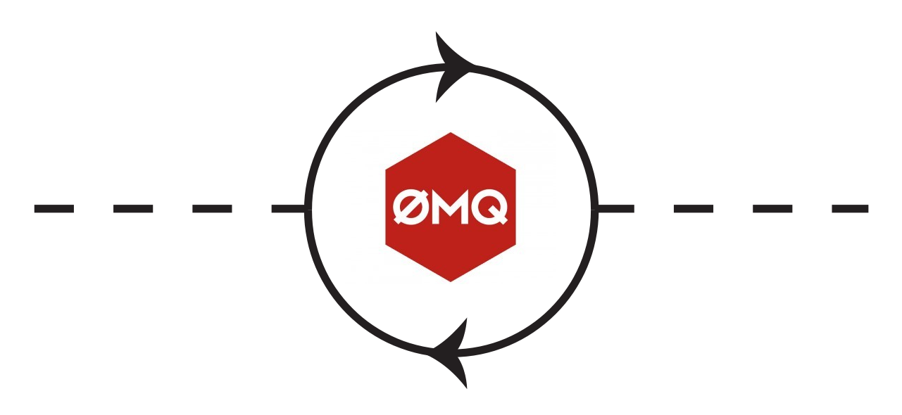

<!--
===============================================
vidgear library source-code is deployed under the Apache 2.0 License:

Copyright (c) 2019 Abhishek Thakur(@abhiTronix) <abhi.una12@gmail.com>

Licensed under the Apache License, Version 2.0 (the "License");
you may not use this file except in compliance with the License.
You may obtain a copy of the License at

   http://www.apache.org/licenses/LICENSE-2.0

Unless required by applicable law or agreed to in writing, software
distributed under the License is distributed on an "AS IS" BASIS,
WITHOUT WARRANTIES OR CONDITIONS OF ANY KIND, either express or implied.
See the License for the specific language governing permissions and
limitations under the License.
===============================================
-->

# NetGear_Async API 

<figure>
  
</figure>

## Overview

> _NetGear_Async is an asyncio port of [NetGear API](../netgear/) that provides complete server-client handling with various options to use variable protocols/patterns similar to NetGear, but lacks in term of flexibility as it supports only [Bidirectional Mode](advanced/bidirectional_mode/) out of all [NetGear's Exclusive Modes](../netgear/#exclusive-modes)._

NetGear_Async is built on [`zmq.asyncio`](https://pyzmq.readthedocs.io/en/latest/api/zmq.asyncio.html) for lag-free video streaming over the network with minimal resource constraints. When NetGear_Async creates its own event loop, it uses the high-performance [**`uvloop`**](https://github.com/MagicStack/uvloop) event loop _(if installed, not on Windows)_. 

NetGear_Async provides complete server-client handling and options to use variable protocols/patterns similar to [NetGear API](../netgear/). Furthermore, NetGear_Async allows us to define our custom Server as source to transform frames easily before sending them across the network(see this [doc](usage/#using-netgear_async-with-a-custom-sourceopencv) example).

NetGear_Async now supports additional [**bidirectional data transmission**](advanced/bidirectional_mode) between receiver(client) and sender(server) while transferring frames. Users can easily build complex applications such as like [Real-Time Video Chat](advanced/bidirectional_mode/#using-bidirectional-mode-for-video-frames-transfer) in just few lines of code.

In addition to all this, NetGear_Async API also provides internal wrapper around [VideoGear](../videogear/), which itself provides internal access to [CamGear](../camgear/), [PiGear](../pigear/), and [FFGear](../ffgear/) APIs, thereby granting it exclusive power for transferring frames incoming from any source to the network.

NetGear_Async as of now supports four ZeroMQ messaging patterns:

- [x] [`zmq.PAIR`](https://learning-0mq-with-pyzmq.readthedocs.io/en/latest/pyzmq/patterns/pair.html) _(ZMQ Pair Pattern)_
- [x] [`zmq.REQ/zmq.REP`](https://learning-0mq-with-pyzmq.readthedocs.io/en/latest/pyzmq/patterns/client_server.html) _(ZMQ Request/Reply Pattern)_
- [x] [`zmq.PUB/zmq.SUB`](https://learning-0mq-with-pyzmq.readthedocs.io/en/latest/pyzmq/patterns/pubsub.html) _(ZMQ Publish/Subscribe Pattern)_ 
- [x] [`zmq.PUSH/zmq.PULL`](https://learning-0mq-with-pyzmq.readthedocs.io/en/latest/pyzmq/patterns/pushpull.html#push-pull) _(ZMQ Push/Pull Pattern)_

Whereas supported protocol are: `tcp` and `ipc`.

!!! info "Event Loop handling"

    NetGear_Async never changes the global _(process-wide)_ event loop policy. If it is created inside a running event loop _(for e.g. inside `asyncio.run()`)_, it uses that loop. Otherwise it creates and owns a new event loop _(`uvloop` if installed and not on Windows, else the default asyncio loop)_, available as its `loop` attribute. See [this usage example ➶](usage/#using-netgear_async-with-asynciorun) for running it inside `asyncio.run()`.

!!! danger "Both ends must run the same vidgear version"

    NetGear_Async transfers each frame as a single ZeroMQ multipart message: a small [`msgspec`](https://jcristharif.com/msgspec/)-validated msgpack header followed by the raw frame buffer. This wire format is **incompatible** with NetGear_Async from older vidgear versions _(which used `msgpack` + `msgpack_numpy`)_, so both Server and Client must be upgraded together, otherwise `recv_generator()` raises a clear `ValueError`. Malformed or hostile messages _(for e.g. object dtype or size mismatch)_ are rejected with a `ValueError` too, and are never unpickled.

!!! tip "Received frames are writeable"

    Frames yielded by `recv_generator()` are regular writeable [`numpy.ndarray`](https://numpy.org/doc/stable/reference/generated/numpy.ndarray.html) arrays, so you can draw on them _(for e.g. with `cv2.putText`)_ directly.

!!! warning "Limitations"

    Unlike [NetGear API](../netgear/), NetGear_Async does **NOT** support Lazy Pirate reconnection _(i.e. its [`max_retries`](../netgear/params/#options) handling)_, [SSH Tunneling Mode](../netgear/advanced/ssh_tunnel/), or Secure Mode's `allowed_ips` whitelist _(only [`secure_mode`](params/#options) CURVE encryption is supported)_. Use NetGear API if you need any of these. Also, any `TimeoutError` _(see [`timeout`](params/#timeout))_ ends `recv_generator()`, so the Client must be restarted.

&thinsp; 

!!! tip "Helpful Tips"

	* It is advised to enable logging(`logging = True`) on the first run for easily identifying any runtime errors.

	* It is advised to comprehend [NetGear API](../netgear/) before using this API.

&thinsp; 

## Usage Examples

<a href="usage/">See here 🚀</a>

!!! example "After going through NetGear_Async Usage Examples, Checkout more bonus examples [here ➶](../../help/netgear_async_ex/)"

## Parameters

<a href="params/">See here 🚀</a>

## References

<a href="../../bonus/reference/netgear_async/">See here 🚀</a>

## FAQs

<a href="../../help/netgear_async_faqs/">See here 🚀</a>

 

&thinsp;