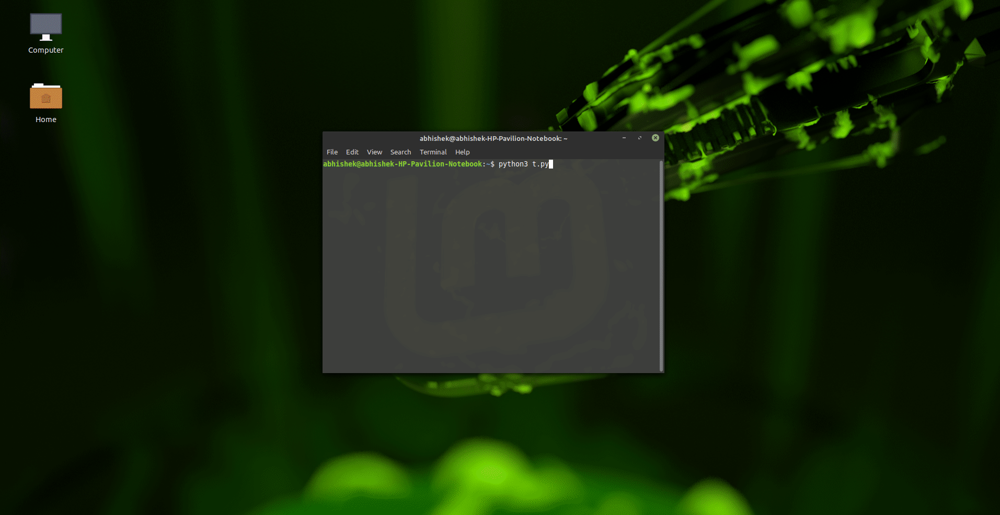
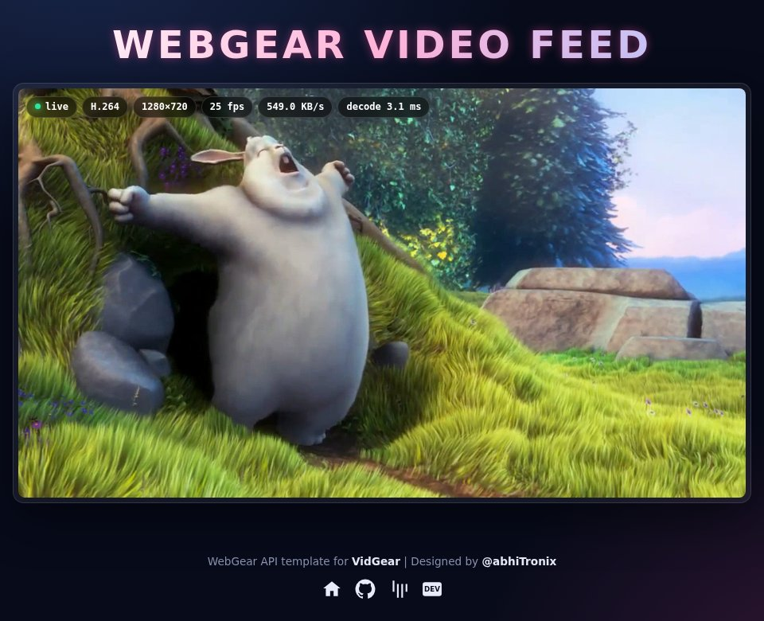
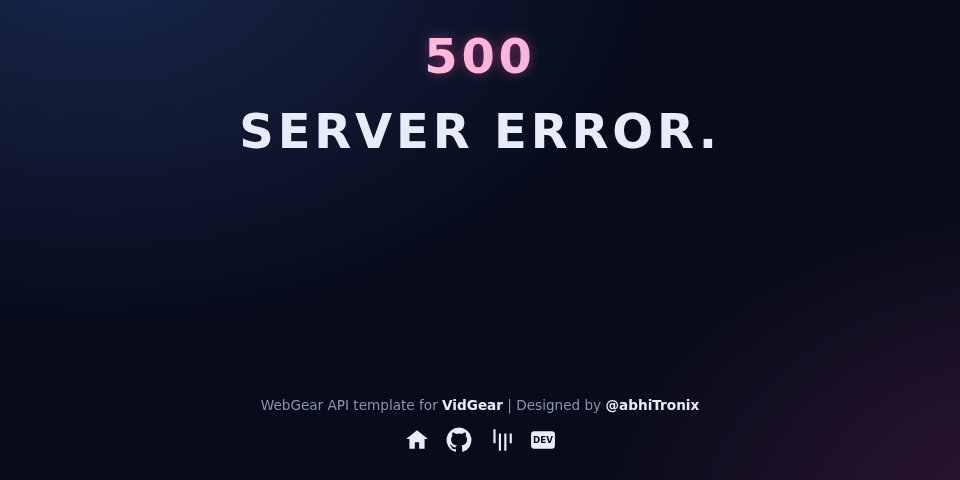

<!--
===============================================
vidgear library source-code is deployed under the Apache 2.0 License:

Copyright (c) 2019 Abhishek Thakur(@abhiTronix) <abhi.una12@gmail.com>

Licensed under the Apache License, Version 2.0 (the "License");
you may not use this file except in compliance with the License.
You may obtain a copy of the License at

   http://www.apache.org/licenses/LICENSE-2.0

Unless required by applicable law or agreed to in writing, software
distributed under the License is distributed on an "AS IS" BASIS,
WITHOUT WARRANTIES OR CONDITIONS OF ANY KIND, either express or implied.
See the License for the specific language governing permissions and
limitations under the License.
===============================================
-->

# WebGear API

<figure>
  
  <figcaption>WebGear API's Video Server running at <a href="http://localhost:8000/" title="default address">http://localhost:8000/</a> address.</figcaption>
</figure>

## Overview

> WebGear is a powerful [ASGI](https://asgi.readthedocs.io/en/latest/) Video-Broadcaster API ideal for transmitting [Motion-JPEG](https://en.wikipedia.org/wiki/Motion_JPEG)-frames _(or low-latency H.264 video)_ from a single source to multiple recipients via the browser.

WebGear API works on [**Starlette**](https://www.starlette.io/)'s ASGI application and provides a highly extensible and flexible async wrapper around its complete framework. WebGear can flexibly interact with Starlette's ecosystem of shared middleware, mountable applications, [Response classes](https://www.starlette.io/responses/), [Routing tables](https://www.starlette.io/routing/), [Static Files](https://www.starlette.io/staticfiles/), [Templating engine(with Jinja2)](https://www.starlette.io/templates/), etc.

WebGear API can stream video in two modes: classic **Motion-JPEG** over HTTP _(default)_, or low-latency **H.264** over WebSockets, both served by a [Uvicorn](https://www.uvicorn.org/#quickstart) ASGI Server. See [Modes of Operation ➶](#modes-of-operation) for their differences.

In layman's terms, WebGear acts as a powerful ==**Video Broadcaster**== that transmits live video-frames to any web-browser in the network. Additionally, WebGear API also provides internal wrapper around [VideoGear](../videogear/), which itself provides internal access to [CamGear](../camgear/), [PiGear](../pigear/), and [FFGear](../ffgear/) APIs, thereby granting it exclusive power for transferring frames incoming from any source to the network.

&thinsp;

## Modes of Operation

!!! new "New in v0.3.7"
    H.264 Mode was added in `v0.3.7`. Previous versions only streamed in MJPEG Mode.

WebGear primarily operates in following modes, selectable with its [`streaming_mode`](params/#streaming_mode) parameter:

=== ":octicons-stack-16: MJPEG Mode _(Default)_"

    When `streaming_mode="mjpeg"` _(default)_, WebGear uses an intraframe-only compression scheme, where each video-frame is separately encoded as a JPEG image with [`simplejpeg`](https://gitlab.com/jfolz/simplejpeg) library, and then streamed as [Motion-JPEG](https://en.wikipedia.org/wiki/Motion_JPEG) over HTTP at `/video` endpoint using Starlette's Multipart [Streaming Response](https://www.starlette.io/responses/#streamingresponse).

    !!! success "Pros"
        * **Lower server CPU:** No FFmpeg encoder process is spawned per viewer.
        * **No FFmpeg required** on the server, and nothing gets downloaded on Windows.
        * Plays on any browser over plain `http://` on any device in the network, without HTTPS.
        * Supports [Custom Sources](advanced/#using-webgear-with-a-custom-sourceopencv), and [JPEG Performance Enhancing Attributes](usage/#bare-minimum-usage-with-default-mjpeg-mode).

    !!! failure "Cons"
        * Many times more bandwidth than H.264, since every frame is a complete JPEG image.
        * Lower visual quality at same bandwidth, and choppier playback on slower networks.

=== ":octicons-device-camera-video-16: H.264 Mode"

    When `streaming_mode="h264"`, WebGear encodes frames into low-latency **H.264** video with [**FFmpeg**](https://ffmpeg.org/) _(`-preset ultrafast -tune zerolatency`)_, and pushes one complete frame per binary message over **WebSockets** at `/ws/video` endpoint. WebGear's Default Theme then decodes them off main-thread with browser's hardware-accelerated [**WebCodecs**](https://developer.mozilla.org/en-US/docs/Web/API/WebCodecs_API) `VideoDecoder` inside a Web Worker, and paints them on a `<canvas>`. The `/video` MJPEG endpoint stays available as well, and the Default Theme automatically falls back to it whenever H.264 can't be played.

    !!! success "Pros"
        * **~9x _(high-motion)_ to ~38x _(static scenes)_ less bandwidth** than MJPEG, since H.264 only encodes changes between frames _(interframe compression)_.
        * Better visual quality at same bandwidth, with ~50ms server-to-canvas latency on `localhost`.
        * Hardware-accelerated decoding off main-thread, so browser stays responsive even at high resolutions.
        * Complete control over encoder with any FFmpeg parameter through [`h264_options`](params/#webgear-specific-attributes) attribute.
        * Automatically falls back to MJPEG on unsupported browsers, insecure origins, or WebSocket failures.

    !!! failure "Cons"
        * **Higher server CPU:** Every connected viewer starts its own FFmpeg encoder process, so server CPU usage grows with the number of viewers.
        * **Requires FFmpeg** with `libx264` encoder on the server. On Windows :fontawesome-brands-windows:, WebGear looks for FFmpeg on startup, and **may download a static FFmpeg build** if none is found _(or set your own with [`custom_ffmpeg`](params/#custom_ffmpeg))_.
        * Browser needs WebCodecs support _(Chrome/Edge 94+, Safari 16.4+, Firefox 130+)_ inside a [Secure Context](https://developer.mozilla.org/en-US/docs/Web/Security/Secure_Contexts) _(i.e. `https://` or `http://localhost`)_, otherwise it falls back to MJPEG.
        * Unavailable with [Custom Sources](advanced/#using-webgear-with-a-custom-sourceopencv), which always stream MJPEG.

!!! tip "Which one to choose?"
    Stick with default **MJPEG Mode** for many simultaneous viewers on a low-power server, plain `http://` access across the network, or when FFmpeg is unavailable. Switch to **H.264 Mode** _(`streaming_mode="h264"`)_ for few viewers, high resolutions, or bandwidth-constrained networks.

???+ abstract "Benchmarks: MJPEG vs H.264 :material-horse-variant-fast:"

    Measured on a 16-core x86-64 Linux machine with FFmpeg 4.4 `libx264` defaults above, against WebGear's default MJPEG settings _(`simplejpeg`, quality `90`, `4:2:2`, `fastdct`)_, on identical 30fps frames _(Big Buck Bunny for motion, a repeated frame for static scene)_:

    | Source | MJPEG | H.264 _(keyframe / median delta)_ | Bandwidth Saving |
    |:--|:--|:--|:--|
    | 720p30, high-motion | 6.32 MB/s | 0.80 MB/s _(168 KB / 25.8 KB)_ | **7.9x** _(87.3%)_ |
    | 1080p30, high-motion | 11.24 MB/s | 1.27 MB/s _(296 KB / 40.1 KB)_ | **8.8x** _(88.7%)_ |
    | 1080p30, static scene | 12.22 MB/s | 0.32 MB/s _(296 KB / 0.22 KB)_ | **38.0x** _(97.4%)_ |

    **Latency:** Server-side frame-in → H.264-frame-out takes **~44-49ms** median _(p95 ≤ 55ms)_, which includes one frame-interval for detecting frame boundaries, plus **~3ms** browser decode on `localhost` _(i.e. ~50ms server-to-canvas, excluding camera capture, network and display)_.

    !!! note "Results vary with content, resolution, CPU and network. Real-world cameras usually lie between the high-motion and static rows."


&thinsp;

## Data-Files Auto-Generation WorkFlow for WebGear

??? tip "Disabling Auto-Generation process in WebGear"

    Starting with vidgear `v0.3.0`, you can now completely disable Auto-Generation process in WebGear API using [`skip_generate_webdata`](params/#webgear-specific-attributes) optional boolean attribute. When `{skip_generate_webdata:True}`, no default data files will be downloaded or validated during initialization.

    !!! warning "Only `/video` route is available when `{skip_generate_webdata:True}` in WebGear API. All other default routes will be JSONResponses with `404`/`500` status codes."

??? note "Customizing default video endpoint path"
	Starting with vidgear `v0.3.1`, you can change default `/video` video endpoint path to any alphanumeric string value, using [`custom_video_endpoint`](params/#webgear-specific-attributes) optional string attribute. For example:

	!!! failure "Only alphanumeric string with no space in between are allowed as `custom_video_endpoint` value. Any other value will be discarded."

	!!! info "WebGear's Default Theme _(v0.2.0+)_ automatically follows the customized video endpoint path _(including H.264's `/ws/<endpoint>` WebSocket path)_."

	```py
	# custom alphanumeric video endpoint string
	options = {"custom_video_endpoint": "xyz"}

	# initialize WebGear app
	web = WebGear(source="foo.mp4", logging=True, **options)
	```
	Hence, default video endpoint will now be available at `/xyz` path.

On initializing WebGear API, it automatically checks for three critical **data files**(i.e `index.html`, `404.html` & `500.html`) inside the `templates` folder, and two **script files**(i.e `custom.js` & `videoFrameDecoderWorker.js`) inside the `static/js` folder of the `webgear` directory at the [_default location_](#default-location) which gives rise to the following two possible scenario:

- [x] **If data-files found:** it will proceed normally for instantiating the Starlette application.
- [ ] **If data-files not found:** it will trigger the [**Auto-Generation process**](#auto-generation-process)

### Default Location

- A _default location_ is the path of the directory where data files/folders are downloaded/generated/saved.
- By default, the `.vidgear` the folder at the home directory of your machine _(for e.g `/home/foo/.vidgear` on Linux :material-linux:)_ serves as the _default location_.
- But you can also use WebGear's [`custom_data_location`](params/#webgear-specific-attributes) dictionary attribute to change/alter _default location_ path to somewhere else.

!!! tip "Identifying Default location"
	You can set [`logging=True`](params/#logging) during initialization, for easily identifying the selected _default location_, which will be something like this on a Linux :material-linux: machine:

	```sh
	WebGear :: DEBUG :: `/home/foo/.vidgear` is the default location for saving WebGear data-files.
	```


### Auto-Generation process

!!! info

    * You can also force trigger the Auto-generation process to overwrite existing data-files using [`overwrite_default_files`](params/#webgear-specific-attributes) dictionary attribute. Remember, only downloaded default data files(given above) will be overwritten in this process but any other file/folder will NOT be affected.

    * It is advised to enable logging(`logging=True`) on the first run for easily identifying any runtime errors.

- On triggering this process, WebGear API creates `webgear` directory, and `templates` and `static` folders inside along with `js`, `css`, `img` sub-folders at the assigned [_default location_](#default-location).
- Thereby at this [_default location_](#default-location), the necessary default data files will be downloaded from a dedicated [**Github Server**](https://github.com/abhiTronix/vidgear-vitals) inside respective folders in the following order:

	```sh
	.vidgear
	└── webgear
	    ├── static
	    │   ├── css
	    │   │   └── custom.css
	    │   ├── img
	    │   │   └── favicon-32x32.png
	    │   └── js
	    │       ├── custom.js
	    │       └── videoFrameDecoderWorker.js
	    └── templates
	        ├── 404.html
	        ├── 500.html
	        ├── base.html
	        └── index.html
	6 directories, 8 files
	```

- Finally these downloaded files thereby are verified for errors and API proceeds for instantiating the Starlette application normally.

&thinsp;

## WebGear's Default Template

??? new "Modernized in v0.3.7"
    WebGear's Default Theme `v0.2.0` adds the H.264 WebCodecs streaming engine with automatic MJPEG fallback, a live telemetry HUD _(status, codec, resolution, FPS, bandwidth & decode latency)_, and a modern dark UI with **zero external dependencies** _(no CDN fonts, icons or scripts)_.

The WebGear API by default uses simple & elegant [**WebGear's Default Theme**](https://github.com/abhiTronix/vidgear-vitals#webgear-default-theme) which looks like something as follows:

### Index.html

_Can be accessed by visiting WebGear app server, running at http://localhost:8000/:_

<h2 align="center">
  
</h2>

### 404.html

_Appears when respective URL is not found, for example http://localhost:8000/ok:_

<h2 align="center">
  
</h2>

### 500.html

_Appears when an API Error is encountered:_

!!! warning "If [`logging`](params/#logging) is enabled and an error occurs, then instead of displaying this 500 handler, WebGear will respond with a traceback response."

<h2 align="center">
  
</h2>

&thinsp;

## Usage Examples

<div>
<a href="usage/">See here 🚀</a>
</div>

!!! example "After going through WebGear Usage Examples, Checkout more bonus examples [here ➶](../../help/webgear_ex/)"

## Parameters

<div>
<a href="params/">See here 🚀</a>
</div>

## References

<div>
<a href="../../bonus/reference/webgear/">See here 🚀</a>
</div>

## FAQs

<div>
<a href="../../help/webgear_faqs/">See here 🚀</a>
</div>

&thinsp;
