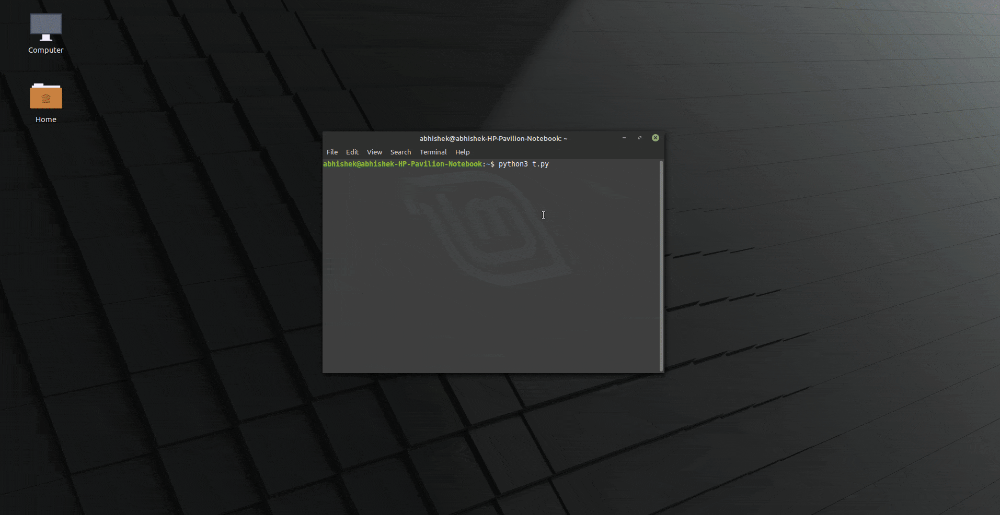
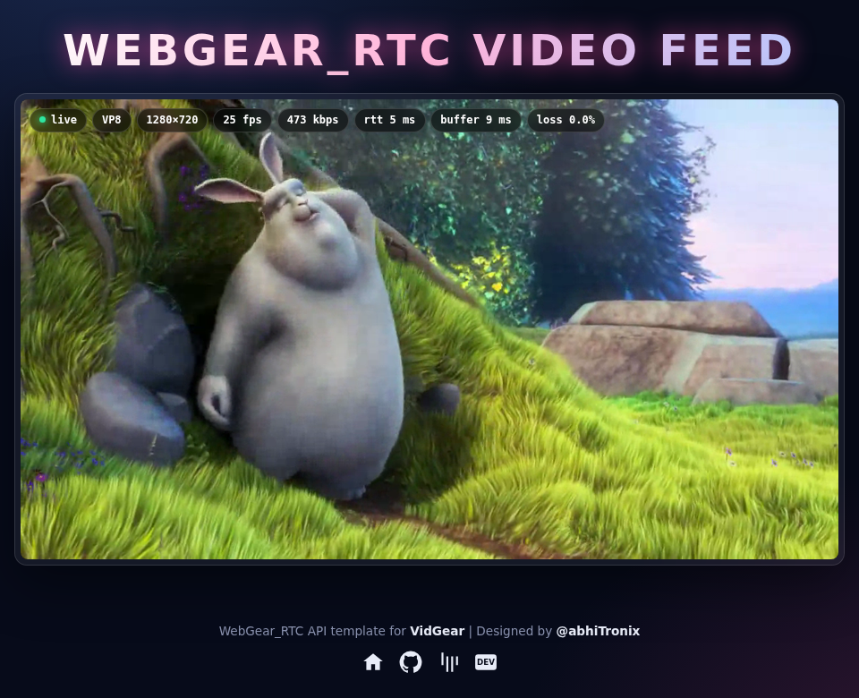
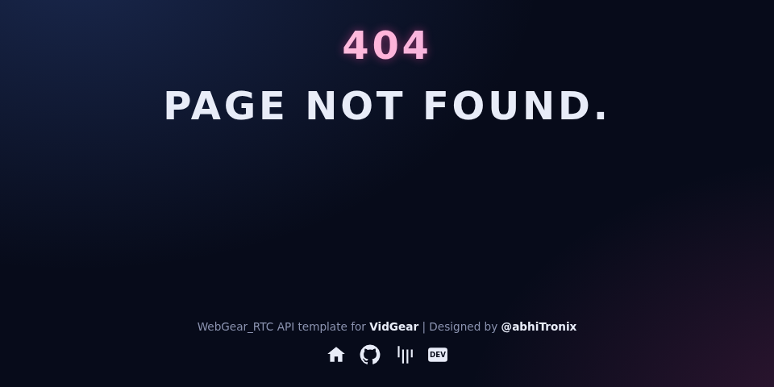
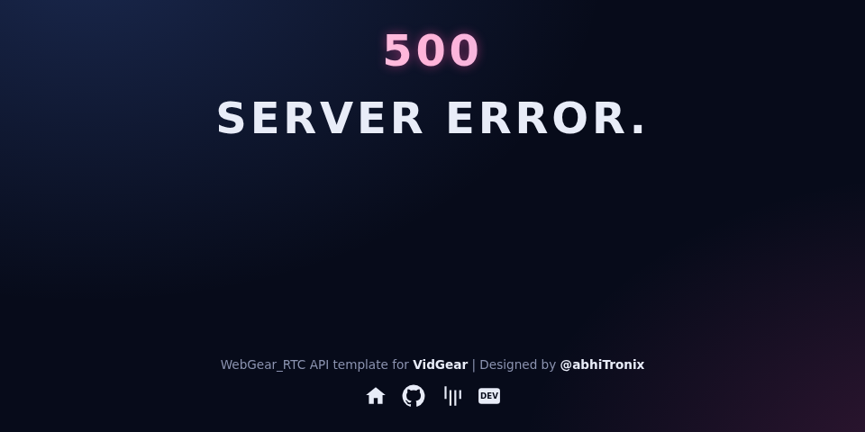

<!--
===============================================
vidgear library source-code is deployed under the Apache 2.0 License:

Copyright (c) 2019 Abhishek Thakur(@abhiTronix) <abhi.una12@gmail.com>

Licensed under the Apache License, Version 2.0 (the "License");
you may not use this file except in compliance with the License.
You may obtain a copy of the License at

   http://www.apache.org/licenses/LICENSE-2.0

Unless required by applicable law or agreed to in writing, software
distributed under the License is distributed on an "AS IS" BASIS,
WITHOUT WARRANTIES OR CONDITIONS OF ANY KIND, either express or implied.
See the License for the specific language governing permissions and
limitations under the License.
===============================================
-->

# WebGear_RTC API 

<figure>
  
  <figcaption>WebGear_RTC API's Video Server running at <a href="http://localhost:8000/" title="default address">http://localhost:8000/</a> address.</figcaption>
</figure>

## Overview

> *WebGear_RTC is similar to [WeGear API](../webgear/) in many aspects but utilizes [WebRTC](https://webrtc.org/) technology under the hood instead of Motion JPEG, which makes it suitable for building powerful video-streaming solutions for all modern browsers as well as native clients available on all major platforms.*

??? new "New in v0.2.1" 
	WebGear_RTC API was added in `v0.2.1`.

WebGear_RTC is implemented with the help of [**aiortc**](https://aiortc.readthedocs.io/en/latest/) library which is built on top of asynchronous I/O framework for Web Real-Time Communication (WebRTC) and Object Real-Time Communication (ORTC) and supports many features like SDP generation/parsing, Interactive Connectivity Establishment with half-trickle and mDNS support, DTLS key and certificate generation, DTLS handshake, etc.

WebGear_RTC can handle [multiple consumers](../webgear_rtc/advanced/#using-webgear_rtc-as-real-time-broadcaster) seamlessly _(every peer gets every frame)_ and supports ICE _(Interactive Connectivity Establishment)_ protocol with user-defined STUN _(Session Traversal Utilities for NAT)_, and TURN _(Traversal Using Relays around NAT)_ servers _(via [`ice_servers`](params/#webgear_rtc-specific-attributes) attribute)_ that help us to seamlessly establish direct media connection with the remote peers for uninterrupted data flow. It also allows us to define our custom streaming class with suitable source to transform frames easily before sending them across the network(see this [doc](../webgear_rtc/advanced/#using-webgear_rtc-with-a-custom-sourceopencv) example).

WebGear_RTC API works in conjunction with [**Starlette**](https://www.starlette.io/) ASGI application and can also flexibly interact with Starlette's ecosystem of shared middleware, mountable applications, [Response classes](https://www.starlette.io/responses/), [Routing tables](https://www.starlette.io/routing/), [Static Files](https://www.starlette.io/staticfiles/), [Templating engine(with Jinja2)](https://www.starlette.io/templates/), etc. 

Additionally, WebGear_RTC API also provides internal wrapper around [VideoGear](../videogear/), which itself provides internal access to [CamGear](../camgear/), [PiGear](../pigear/), and [FFGear](../ffgear/) APIs.

&thinsp;

## Data-Files Auto-Generation WorkFlow for WebGear_RTC

Same as [WebGear](../webgear/), WebGear_RTC API automatically checks for critical **data files**(i.e `index.html`, `404.html` & `500.html` inside the `templates` folder, and `custom.js` inside the `static/js` folder) on initialization of the `webgear_rtc` directory at the [*default location*](#default-location) which gives rise to the following two possible scenario:

- [x] **If data-files found:** it will proceed normally for instantiating the WebRTC media server through Starlette application.
- [ ] **If data-files not found:** it will trigger the [**Auto-Generation process**](#auto-generation-process)

### Default Location

* A _default location_ is the path of the directory where data files/folders are downloaded/generated/saved.
* By default, the `.vidgear` the folder at the home directory of your machine _(for e.g `/home/foo/.vidgear` on Linux :material-linux:)_ serves as the _default location_.
* But you can also use WebGear_RTC's [`custom_data_location`](params/#webgear_rtc-specific-attributes) dictionary attribute to change/alter *default location* path to somewhere else.

!!! tip "Identifying Default location"
	You can set [`logging=True`](params/#logging) during initialization, for easily identifying the selected _default location_, which will be something like this on a Linux :material-linux: machine:

	```sh
	WebGear_RTC :: DEBUG :: `/home/foo/.vidgear` is the default location for saving WebGear_RTC data-files.
	```


### Auto-Generation process

!!! info

	* You can also force trigger the Auto-generation process to overwrite existing data-files using [`overwrite_default_files`](params/#webgear_rtc-specific-attributes) dictionary attribute. Remember, only downloaded default data files(given above) will be overwritten in this process but any other file/folder will NOT be affected.

	* It is advised to enable logging(`logging=True`) on the first run for easily identifying any runtime errors.


* On triggering this process, WebGear_RTC API creates `webgear_rtc` directory, and `templates` and `static` folders inside along with `js`, `css`, `img` sub-folders at the assigned [*default location*](#default-location).
* Thereby at this [*default location*](#default-location), the necessary default data files will be downloaded from dedicated [**vidgear-vitals**](https://github.com/abhiTronix/vidgear-vitals) repository _(GitLab mirror first, GitHub as fallback)_ inside respective folders in the following order:

	```sh
		.vidgear
		└── webgear_rtc
		    ├── static
		    │   ├── css
		    │   │   └── custom.css
		    │   ├── img
		    │   │   └── favicon-32x32.png
		    │   └── js
		    │       └── custom.js
		    └── templates
		        ├── 404.html
		        ├── 500.html
		        ├── base.html
		        └── index.html
		6 directories, 7 files
	```

* Finally these downloaded files thereby are verified for errors and API proceeds for instantiating the Starlette application normally.

&thinsp;

## WebGear_RTC's Default Template

The WebGear_RTC API by default uses simple & elegant [**WebGear_RTC's Default Theme**](https://github.com/abhiTronix/vidgear-vitals#webgear_rtc-default-theme) which looks like something as follows:

??? new "New in Default Theme v0.2.0"
    - [x] **Real-time Performance Overlay:** live status, codec, resolution, FPS, bitrate, round-trip time, jitter-buffer delay and packet-loss pills, read from browser's WebRTC `getStats()`.
    - [x] **Auto-Reconnect:** reconnects with backoff when connection fails or stream stalls, frees its server peer on page reload/close, and shows `ended` once stream is over.
    - [x] **Zero external dependencies:** no CDN fonts, icon packs or scripts, and no hard-coded public STUN server. Endpoints are relative, so it also works behind reverse-proxy sub-paths.
    - [x] Modern dark UI _(same as WebGear's theme)_ with click-to-toggle fullscreen.

    Existing installs keep their old files, so use [`overwrite_default_files`](params/#webgear_rtc-specific-attributes) attribute once to get it.

### Index.html

*Can be accessed by visiting WebGear_RTC app server, running at http://localhost:8000/:*

<h2 align="center">
  
</h2>


### 404.html

*Appears when respective URL is not found, for example http://localhost:8000/ok:*

<h2 align="center">
  
</h2>


### 500.html

*Appears when an API Error is encountered:*

!!! warning "If [`logging`](params/#logging) is enabled and an error occurs, then instead of displaying this 500 handler, WebGear_RTC will respond with a traceback response."

<h2 align="center">
  
</h2>

&thinsp;

## Limitations

- [x] **Codecs:** only VP8 and H.264 video _(aiortc's encoders)_, with aiortc's own bitrate ranges _(H.264: `0.5-3 Mbps`, VP8: `0.25-1.5 Mbps`)_. Use [`codec`](params/#webgear_rtc-specific-attributes) attribute to force one. Frames with odd width/height are cropped by one pixel to even dimensions.
- [x] **Framerate:** frames are paced at source's framerate _(if reported by the source, up to `120`)_, otherwise at `30` fps.
- [x] **Video only:** no audio or data channels.
- [x] **Source is paused** while no peer is connected, and once the source ends _(without [`enable_infinite_frames`](params/#webgear_rtc-specific-attributes))_, new peers are refused with HTTP `503` until the app is restarted.
- [x] **No authentication:** `/`, `/offer` and `/close_connection` endpoints are public, see [native clients ➶](advanced/#using-webgear_rtc-with-nativenon-browser-clients).

&thinsp;

## Usage Examples

<div>
<a href="usage/">See here 🚀</a>
</div>

!!! example "After going through WebGear_RTC Usage Examples, Checkout more bonus examples [here ➶](../../help/webgear_rtc_ex/)"

## Parameters

<div>
<a href="params/">See here 🚀</a>
</div>

## References

<div>
<a href="../../bonus/reference/webgear_rtc/">See here 🚀</a>
</div>

## FAQs

<div>
<a href="../../help/webgear_rtc_faqs/">See here 🚀</a>
</div>

&thinsp;